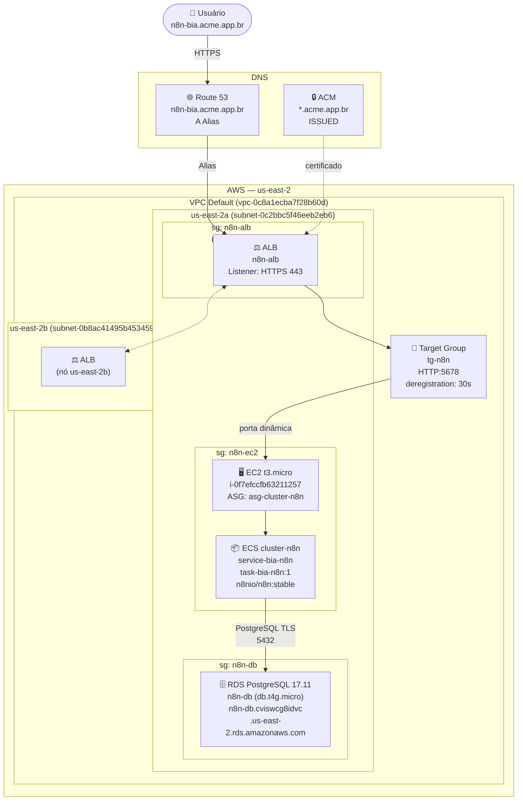
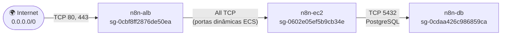
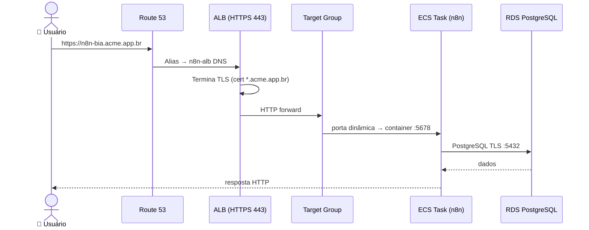

# Diagrama de Arquitetura — n8n na AWS

**Região:** us-east-2 (Ohio)  
**Conta:** 600579993826  
**Data:** 2026-11-03  

---

## Diagrama

---

## Legenda dos Recursos

| Ícone | Recurso | ID / ARN |
|---|---|---|
| 🌐 | Route 53 `n8n-bia.acme.app.br` | Hosted Zone `Z03773583SL3DJ9VMWZ2H` |
| 🔒 | ACM `*.acme.app.br` | `arn:aws:acm:us-east-2:600579993826:certificate/7a78ed7e-a696-4b03-9820-7c5c22066728` |
| ⚖️ | ALB `n8n-alb` | `arn:...:loadbalancer/app/n8n-alb/13172bdeb496c4b1` |
| 🎯 | Target Group `tg-n8n` | `arn:...:targetgroup/tg-n8n/b946b2dc64bdf4a1` |
| 🖥️ | EC2 `i-0f7efccfb63211257` | `t3.micro` — ASG `asg-cluster-n8n` |
| 📦 | ECS `service-bia-n8n` | `arn:aws:ecs:us-east-2:600579993826:service/cluster-n8n/service-bia-n8n` |
| 🗄️ | RDS `n8n-db` | `arn:aws:rds:us-east-2:600579993826:db:n8n-db` |

---

## Security Groups — Fluxo de Acesso

---

## Fluxo de Requisição

